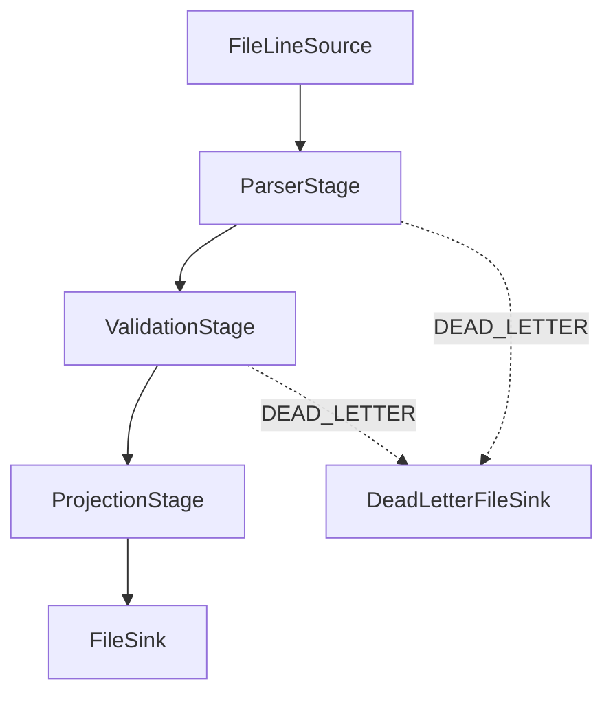

# LogFlow v5 Mimarisi

## Genel akış

YAML dosyası kaynak, sıralı aşamalar, ana hedef, dead-letter hedefi ve her
aşamanın hata politikasını tanımlar. `PipelineLoader` bütün tipleri ve
parametreleri veri okunmadan önce doğrular.



`FileLineSource` satırları doğrudan UTF-8 metne çevirmek yerine ham byte olarak
okur. Böylece geçersiz UTF-8 JVM tarafından kaybedilmez; `ParserStage` bunu bir
`StageException` olarak üretir ve YAML politikası karar verir.

## Recoverable ve fatal hata ayrımı

| Hata sınıfı | Anlam | Sonuç |
|---|---|---|
| `StageException` | Tek bir kayda ait, kurtarılabilir hata | Aşamanın `onError` politikası uygulanır |
| `PipelineException` | Dosya açılamaması, sink yazma hatası veya tükenen retry gibi fatal hata | Pipeline durur |
| `ConfigException` | Geçersiz YAML/şema/tip/parametre | Veri işlenmeden önce pipeline durur |

`ConfigException`, yapılandırma hatalarının da fatal olduğunu açıkça göstermek
için `PipelineException` sınıfından türetilmiştir.

## Kayıt bazlı politika uygulaması

`StageNode`, her girdi kaydını tek başına işler:

| Politika | Davranış |
|---|---|
| `FAIL_FAST` | `StageException`, `PipelineException` olarak yükseltilir |
| `SKIP` | Kayıt atılır ve ilgili aşamanın drop sayacı artar |
| `DEAD_LETTER` | `FailedRecord` oluşturulur ve bağımsız kanala yazılır |
| `RETRY(n)` | Aynı kayıt `n` kez daha denenir; başarısızlık sürerse fatal olur |

`FailedRecord` şu bilgileri taşır: `rawInput`, `stageName`, `exception`,
`timestamp`. Ana `FileSink` ile dead-letter sink birbirinden bağımsız açılır,
yazılır ve kapatılır.

## ValidationStage

Doğrulama davranışı YAML tarafından belirlenir:

```yaml
- type: validate
  onError: DEAD_LETTER
  params:
    requiredFields: [clientIp, method, path]
    bytesRange: { min: 0 }
    statusRange: { min: 100, max: 599 }
    timestampRange:
      min: "2020-01-01T00:00:00Z"
      max: "2030-12-31T23:59:59Z"
    ipFormat: ipv4
```

Bu tasarımda yeni sınırlar için Java sınıfını değiştirmek gerekmez; YAML değeri
değiştirilir.

## Chaos testi hata-politika eşlemesi

| Fixture durumu | Hatanın oluştuğu aşama | Politika | Sonuç |
|---|---|---|---|
| Başlık/açıklama satırı | `parse` | `DEAD_LETTER` | Dead-letter |
| Kesilmiş iki satır | `parse` | `DEAD_LETTER` | Dead-letter |
| Geçersiz UTF-8 | `parse` | `DEAD_LETTER` | Dead-letter |
| 100 KiB satır | `parse` | `DEAD_LETTER` | Dead-letter |
| Negatif byte değeri | `validate` | `DEAD_LETTER` | Dead-letter |
| 1970 timestamp | `validate` | `DEAD_LETTER` | Dead-letter |
| 2099 timestamp | `validate` | `DEAD_LETTER` | Dead-letter |
| Üç geçerli kayıt | Tüm aşamalar | - | Ana çıktı |
| Boş dosya | Hata oluşmaz | - | 0 girdi, başarılı bitiş |

Sonuç: `11 input = 3 output + 0 dropped + 8 dead-letter`.

## RunSummary ve uzlaştırma

`RunSummary` gerçek `System.nanoTime()` farkıyla süreyi ölçer ve şunları tutar:

- toplam girdi sayısı,
- toplam ana çıktı sayısı,
- aşama bazında drop sayısı,
- dead-letter sayısı,
- gerçek geçen süre.

Başarılı bir çalışmanın temel kontrolü:

`input = output + totalDropped + deadLetter`

`counts reconcile: true` değeri hiçbir kaydın sessizce kaybolmadığını gösterir.

## Yaşam döngüsü

Pipeline önce aşamaları, sonra ana sink'i ve varsa dead-letter sink'ini açar.
Çalışma başarısız olsa bile `finally` blokları bütün açılmış bileşenleri kapatır
ve geçen süreyi tamamlar. Dosya okuma/yazma hataları kayıt hatası olmadığı için
politikalardan geçirilmez; doğrudan fatal `PipelineException` üretir.
